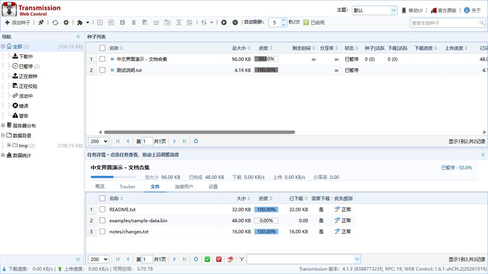

# Transmission Web Control 中文适配版

沿用“栽培者 / ronggang”的 **Transmission Web Control 1.6.1**，保留经典中文表格界面，适配 **Transmission 4.1.3**。这是独立的非官方社区适配项目，原作者、Transmission 和 SynoCommunity 均未为本包背书。

**[下载安装包](https://github.com/wzya2026/transmission-web-control-zhcn/releases)** · [安装与恢复](docs/安装与恢复.md) · [验证范围](docs/验证范围.md) · [后续升级](docs/后续升级.md) · [开发记录](docs/开发记录-2026-10-19.md)



## 适合谁

- DS423+（Geminilake）等 x86_64 群晖，DSM 7.1-42661 或以上。完整架构列表保留在 SPK 的 INFO 中。
- 已装官方套件、只想更换中文网页的用户，可以使用网页包和备份/恢复脚本。
- **不适用于没有“+”的 DS423（ARM）**，也不是所有群晖型号通用的安装包。

网页版本 **1.6.1-zhCN.2**，自定义套件版本 **4.1.3-3102**。安装包未签名，**已在 SA6400 / DSM 7.4.1 上通过 DSM 套件管理命令实际升级并启动**；DS423+ 全新安装尚未实测。本版继续标为预发行版本。

## 这次改了什么

- 桌面式上下分栏：点选任务自动显示下方详情；横向标签、进度及速度摘要，详情区可拖动调整高度。

- 默认简体中文，补充主题名称、参数页和安装向导的中文。
- 在原有客户端与服务端之间加入 JSON-RPC 2.0 适配层，处理新旧字段名称、缓存单位、最近活动任务和会话重试。
- 增加全局及单任务顺序下载、默认公开 Tracker、IPv4/IPv6 端口检查。
- 保留原界面及官方英文网页入口，停用归档项目的旧更新提示。
- 不改 Transmission 下载内核。16 个随包可执行文件和库文件均与 SynoCommunity 原包逐一校验一致。

## 下载与安装

到 **Releases** 下载 `Transmission-4.1.3-3102-zhCN-x64-DSM7.spk`，在“套件中心 → 手动安装”选择它。先备份已有套件的配置、任务记录；不要通过卸载旧版来完成升级。Transmission 的网页账号由安装向导单独设置，不是 DSM 管理员账号。

已安装官方 Transmission 的用户，也可以下载网页压缩包、`web-ui.sha256` 及两个 `.sh` 脚本，按照[安装与恢复](docs/安装与恢复.md)只替换网页。脚本会备份旧网页，保留下载服务及任务。

默认中文网页地址：`http://NAS地址:9091/transmission/web/`。升级后按 `Ctrl+F5` 清除旧页面缓存。

## 从源码构建

需要 Python 3.12 或以上；无需安装 Python 第三方依赖：

```sh
python tools/build.py
```

脚本从 `sources.lock.json` 指定的地址获取原 SPK 和原作者源码，验证 SHA256，再应用 `tools/build_twc.py` 中的改动并打包。输出位于 `dist/`，工作目录位于 `.build/`。下载内核直接保留原 SPK 中的文件，**此命令不是重新编译 Transmission**。

首次发布同时保留经过审核的成品校验值。构建结束会与 `release-manifest.json` 比对，确认生成的 SPK 与已验证的发布文件一致。修改版本时须按[后续升级](docs/后续升级.md)更新版本、来源锁定和验证记录。

维护源码：`src/rpc-compat.js` 为接口适配层，`tools/build_twc.py` 为网页增量修改，`tools/package_release.py` 为套件重打包。`patches/` 提供首版相对原作者源码的差异，完整网页可由固定来源重建。

## 来源与许可

感谢 [ronggang/transmission-web-control](https://github.com/ronggang/transmission-web-control)、[Transmission](https://github.com/transmission/transmission) 和 [SynoCommunity/spksrc](https://github.com/SynoCommunity/spksrc)。新适配代码及构建工具以 MIT 发布；上游及第三方组件保留各自许可证，详见 [THIRD_PARTY.md](THIRD_PARTY.md)。

仓库与 Release 不含 NAS 凭据、实际下载任务、私有 Tracker 或订阅。请勿在 Issue 上传含密码、Cookie、种子 passkey 的日志或配置。
